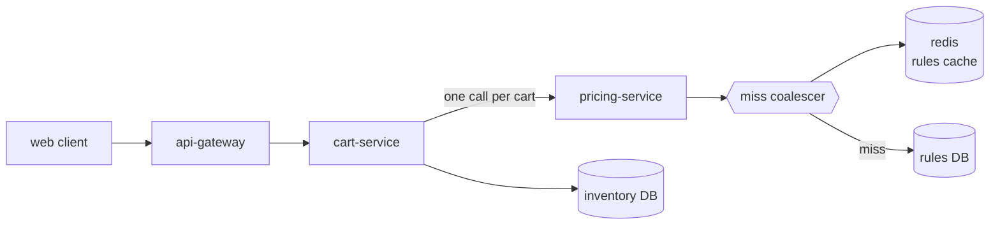
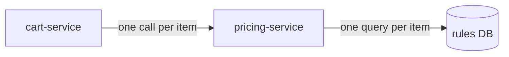
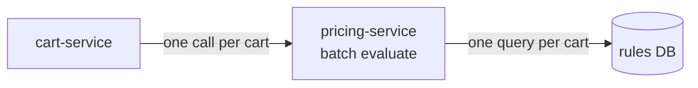
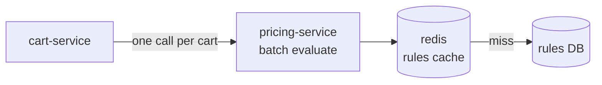
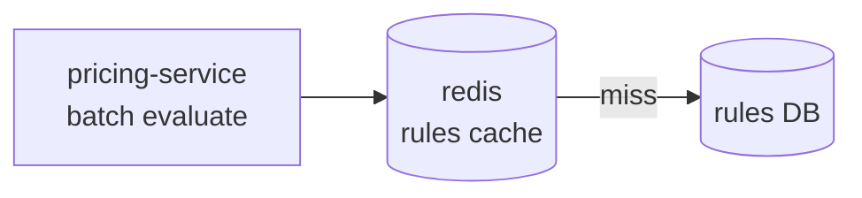
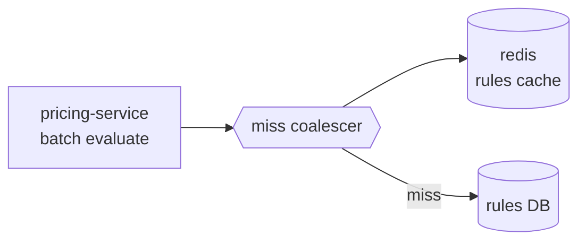

# Checkout latency

> This is a made-up example project. It shows the project-log format: every name and number here is invented.

## Now

Checkout prices a whole cart in one batched call. Price rules come from a shared cache, and concurrent misses are coalesced into one database read.



| scenario | baseline p95 (ms) | now p95 (ms) | vs baseline |
|---|---|---|---|
| 1–5 items | 280 | 285 | +1.8 % |
| 21–50 items | 400 | 430 | +7.5 % |
| promotion-heavy carts | 420 | 489 | +16.4 % |
| replayed prod traffic | 410 | 421 | +2.7 % |

### Open

- [ ] Promotion-heavy carts are 16 % over baseline: rule evaluation itself, not I/O.
- [ ] Add a per-cart pricing span to the traces.

## Terms

- **cart-service**: owns the cart and asks pricing-service for prices at checkout.
- **pricing-service**: applies price rules (discounts, promotions, taxes) to cart items.
- **rules DB**: the database of price rules. It's slow (~40 ms a query) and is the bottleneck under load.
- **redis / rules cache**: shared in-memory cache of price rules, 60 s TTL.
- **miss coalescer**: when many requests miss the cache for the same key at once, only the first reads the DB and the rest wait for its answer.
- **p95**: the latency that 95 % of requests beat.
- **cache stampede**: many requests missing the cache at the same moment and all hitting the database.

## Log

### 2026-09-24 · Price the whole cart in one call

> cart-service made one pricing call per item, so 50-item carts paid 50 round trips. One batched call brings 21–50-item carts from 610 to 455 ms.

#### Before



#### After



#### Example

```scenario
{
 "title": "Three items, three round trips",
 "unit": "ms",
 "illustrative": true,
 "lanes": [
  "cart-service",
  "pricing-service",
  "rules DB"
 ],
 "before": {
  "caption": "Each item waits for the previous item's price.",
  "result": "done at 135 ms",
  "events": [
   {
    "lane": "cart-service",
    "from": 0,
    "to": 135,
    "text": "waiting on prices",
    "status": "wait"
   },
   {
    "lane": "pricing-service",
    "from": 0,
    "to": 45,
    "text": "item 1"
   },
   {
    "lane": "rules DB",
    "from": 2,
    "to": 42,
    "text": "query 1"
   },
   {
    "lane": "pricing-service",
    "from": 45,
    "to": 90,
    "text": "item 2",
    "status": "bad"
   },
   {
    "lane": "rules DB",
    "from": 47,
    "to": 87,
    "text": "query 2",
    "status": "bad"
   },
   {
    "lane": "pricing-service",
    "from": 90,
    "to": 135,
    "text": "item 3",
    "status": "bad"
   },
   {
    "lane": "rules DB",
    "from": 92,
    "to": 132,
    "text": "query 3",
    "status": "bad"
   }
  ]
 },
 "after": {
  "caption": "All items go in one request; the rules for the cart come back in one query.",
  "result": "done at 55 ms",
  "events": [
   {
    "lane": "cart-service",
    "from": 0,
    "to": 55,
    "text": "waiting on prices",
    "status": "wait"
   },
   {
    "lane": "pricing-service",
    "from": 0,
    "to": 55,
    "text": "items 1–3, batched",
    "status": "good"
   },
   {
    "lane": "rules DB",
    "from": 2,
    "to": 45,
    "text": "one query",
    "status": "good"
   }
  ]
 }
}
```

#### Decisions

- **Batch per cart, not per item.** Round trips, not rule evaluation, were 80 % of checkout time.
- **Rejected: parallel per-item calls.** It cuts latency but multiplies DB load by the cart size.

#### Results

| cart size | p95 before (ms) | p95 after (ms) |
|---|---|---|
| 1–5 | 290 | 285 |
| 6–20 | 380 | 330 |
| 21–50 | 610 | 455 |
| 51+ | 980 | 520 |

### 2026-09-26 · Cache price rules in redis

> Rules change a few times a day but were read on every checkout. A shared 60 s cache takes the DB off the hot path.

#### Before


#### After



#### Decisions

- **Shared redis cache, 60 s TTL.** Rule edits show up within a minute, which merchandising accepted.
- **Rejected: an in-process cache.** Each of the 12 pods would hold different rules for up to a minute.

#### Results

| metric | before | after |
|---|---|---|
| rules DB queries / s | 310 | 9 |
| p95, 21–50 items (ms) | 455 | 420 |

#### Open

- [ ] Every 60 s, p99 spikes to 1.9 s when the hot keys expire.

### 2026-09-28 · Coalesce concurrent cache misses

> When a hot rule set expired, every in-flight checkout queried the DB at once: a cache stampede. Now the first miss fetches and the others wait for it.

#### Before



#### After



#### Example

```scenario
{
 "title": "Three checkouts miss the same key",
 "unit": "ms",
 "illustrative": true,
 "lanes": [
  "checkout A",
  "checkout B",
  "checkout C",
  "rules DB"
 ],
 "before": {
  "caption": "All three miss at once and all three query the DB. The queries queue behind each other.",
  "result": "C waits until 150 ms",
  "events": [
   {
    "lane": "checkout A",
    "at": 0,
    "text": "miss"
   },
   {
    "lane": "checkout B",
    "at": 2,
    "text": "miss"
   },
   {
    "lane": "checkout C",
    "at": 4,
    "text": "miss"
   },
   {
    "lane": "rules DB",
    "from": 0,
    "to": 50,
    "text": "query for A"
   },
   {
    "lane": "rules DB",
    "from": 50,
    "to": 100,
    "text": "query for B",
    "status": "bad"
   },
   {
    "lane": "rules DB",
    "from": 100,
    "to": 150,
    "text": "query for C",
    "status": "bad"
   },
   {
    "lane": "checkout C",
    "from": 4,
    "to": 150,
    "text": "waiting",
    "status": "wait"
   }
  ]
 },
 "after": {
  "caption": "A's miss fetches; B and C attach to A's fetch instead of starting their own.",
  "result": "all three done at 50 ms",
  "events": [
   {
    "lane": "checkout A",
    "at": 0,
    "text": "miss: fetch"
   },
   {
    "lane": "checkout B",
    "at": 2,
    "text": "miss: wait for A",
    "status": "good"
   },
   {
    "lane": "checkout C",
    "at": 4,
    "text": "miss: wait for A",
    "status": "good"
   },
   {
    "lane": "rules DB",
    "from": 0,
    "to": 50,
    "text": "one query",
    "status": "good"
   },
   {
    "lane": "checkout C",
    "from": 4,
    "to": 50,
    "text": "waiting",
    "status": "wait"
   }
  ]
 }
}
```

#### Decisions

- **Coalesce in pricing-service, keyed by rule set.** It's one in-memory map per pod and needs no new infrastructure.
- **Rejected: never-expiring cache with push invalidation.** Better long term, but it needs a change feed from the rules DB.

#### Results

| metric | before | after |
|---|---|---|
| p99 at key expiry (ms) | 1,900 | 480 |
| DB queries per expiry | 140 | 1 |

### 2026-10-02 · Validate against production traffic

> Replayed one day of production checkouts. Everything is within the ±10 % target except promotion-heavy carts.

#### Results

| scenario | baseline p95 (ms) | now p95 (ms) | vs baseline |
|---|---|---|---|
| 1–5 items | 280 | 285 | +1.8 % |
| 21–50 items | 400 | 430 | +7.5 % |
| promotion-heavy carts | 420 | 489 | +16.4 % |
| replayed prod traffic | 410 | 421 | +2.7 % |

#### Open

- [ ] Profile rule evaluation for carts with more than 5 stacked promotions.
