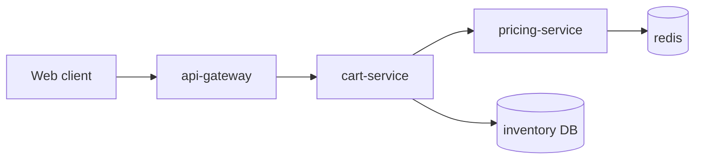

# Checkout latency investigation

Status: **in progress** (2026-09-28). Owner: platform team. Goal: p95 checkout latency **≤10 %** above the August baseline.

## 1. Context (2026-09-22)

Checkout p95 rose from 410 ms to 560 ms after the September release. The regression shows up only for carts with more than 20 items.



**Decision (2026-09-22):** treat this as a release blocker; roll forward instead of rolling back.

## 2. Measurements (2026-09-24)

<!-- viz: chart=bars series="p50,p95" title="Latency by cart size (ms)" -->

| cart size | p50 | p95 | p99 |
|---|---|---|---|
| 1–5 | 120 ms | 290 ms | 410 ms |
| 6–20 | 160 ms | 380 ms | 520 ms |
| 21–50 | 240 ms | 610 ms | 900 ms |
| 51+ | 410 ms | 980 ms | 1400 ms |

**Found:** `pricing-service` calls `PriceRules.evaluate()` once per item instead of once per cart. See `services/pricing/rules.go:212`.

## 3. Fix and validation (2026-09-27)

* Batched the rule evaluation in `services/pricing/rules.go`. `pricing.batch_size` 1 -> 64.
* **Result:** p95 back to 430 ms on the load test.
* **Caveat:** the load test uses synthetic carts; real carts carry more promotions.

| scenario | baseline p95 | after fix p95 | vs baseline |
|---|---|---|---|
| synthetic 1–5 | 280 | 290 | +3.6 % |
| synthetic 21–50 | 400 | 455 | +13.8 % |
| replayed prod traffic | 410 | 430 | +4.9 % |

```chart
{"type": "line", "title": "Daily p95 (ms)", "labels": ["09-20","09-21","09-22","09-23","09-24","09-25","09-26","09-27","09-28"],
 "series": [{"name": "p95", "values": [415, 412, 560, 571, 566, 548, 540, 455, 430]}], "unit": "ms", "target": 450}
```

## 4. Next steps

1. [x] Batch rule evaluation
2. [ ] Add a per-cart pricing span to traces
3. [ ] Re-run with promotion-heavy carts

**Open:** does `pricing.batch_size` 64 hurt the cache hit rate? Needs a week of prod data (see §3).
