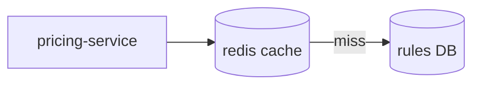
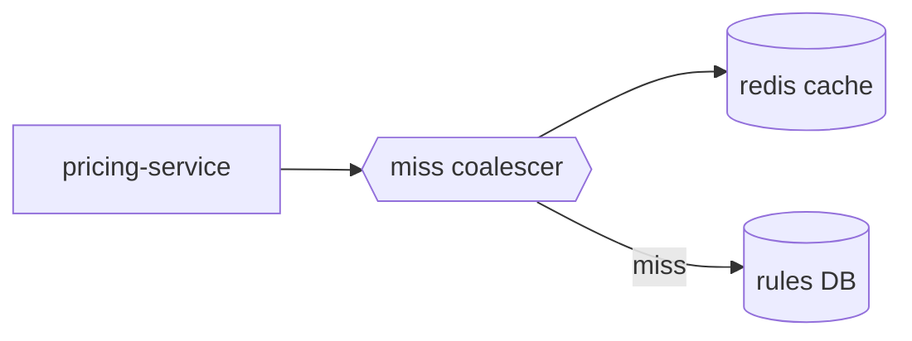

# Project log

Each project the user works on has **one log file**. It is the project's timeline. The user reads it in mdviz,
which shows a strip of dated entries, each entry's **Before → After** diagrams side by side (added, changed,
and removed parts are highlighted automatically), the decisions, and the current system. Write for that view:
**diagrams first, very little text.**

Template: `template.md` in this skill's folder. Copy it to start a new log.

## Where the log lives

- Use the path named in the repo's `CLAUDE.md` (`Project log: <path>`).
- If there is none, use `~/project-logs/<project-slug>.md`.
- One project, one file, even when the work spans several repos.

## When to add an entry

- Add an entry after a **meaningful change**: a design change, a new component, a calibration round, or a fix that
  changes behavior or numbers. Batch small changes. Most sessions add zero or one entry.
- Append at the bottom of `## Log` in date order. Don't rewrite old entries, except to correct a fact.
- Then update `## Now` (see below).

## Entry format: hard limits

````markdown
### 2026-09-28 · Coalesce concurrent cache misses

> A hot key expiring sent every in-flight request to the DB at once. Now the first miss fetches and the rest wait.

#### Before


#### After


#### Decisions
- **Coalesce in the service, keyed by rule set.** One map per pod, no new infrastructure.
- **Rejected: push invalidation.** Needs a change feed the DB doesn't have yet.

#### Results
| metric | before | after |
|---|---|---|
| p99 at key expiry (ms) | 1,900 | 480 |
````

| Part | Rule |
|---|---|
| Heading | `### YYYY-MM-DD · <what changed>`, ≤ 8 words. Always an ISO date. |
| Summary | One `>` line, ≤ 30 words: the change and its effect. |
| Before / After | One mermaid diagram each, ≤ 10 nodes, showing **only the part that changed**. **Keep the same node ids for unchanged parts.** The viewer diffs by id: new ids show green, renamed labels amber, dropped ids red. Use `flowchart` for structure and `sequenceDiagram` for ordering or timing. Omit Before for something brand new. |
| Decisions | 1–3 bullets: `- **<decision>.** <why, one sentence>.` Record a rejected alternative as `- **Rejected: <x>.** <why>.` |
| Results | Optional table, ≤ 6 rows. Numbers with units. Errors as signed percent (`−2.3 %`). The viewer charts percent columns against the goal's target. |
| Open | Optional task list (`- [ ]`) of what this change leaves unresolved. |
| Example | **Add one when a decision depends on timing, ordering, or a failure mode** that a static diagram can't show. It's a `scenario` block (below) that shows the failing case and the fixed case on the same time axis. The viewer plays it step by step. |

Not in the log: narration of how you got there, file inventories, code listings, long tables. Those belong in
commits, code comments, or a separate doc. Link one if needed.

## Example: the interactive "where it failed, and the fix"

A `scenario` block draws lanes (actors or resources) over time, Before and After, with a playhead the reader
can scrub. Use it to make a decision understandable without reading code:

````markdown
#### Example
```scenario
{"title": "Three requests miss the same key", "unit": "ms", "illustrative": true,
 "lanes": ["request A", "request B", "rules DB"],
 "before": {"caption": "Each miss queries the DB itself.", "result": "B waits until 100 ms",
   "events": [{"lane": "rules DB", "from": 0, "to": 50, "text": "query for A"},
              {"lane": "rules DB", "from": 50, "to": 100, "text": "query for B", "status": "bad"}]},
 "after":  {"caption": "B attaches to A's fetch.", "result": "both done at 50 ms",
   "events": [{"lane": "rules DB", "from": 0, "to": 50, "text": "one query", "status": "good"},
              {"lane": "request B", "at": 2, "text": "miss: wait for A", "status": "good"}]}}
```
````

- An event is a span (`from` / `to`) or an instant (`at`). `status` is `bad` (the failure), `good` (the
  fix), `wait` (stalled), or omitted.
- 2–5 lanes, ≤ 12 events per side. Use the same lanes on both sides.
- Use **real numbers when you have them** (latencies from a waveform or trace). Otherwise set
  `"illustrative": true`: the viewer then labels the timing as schematic. Never present made-up timing as
  measured.

## Terms: context on hover

Keep a `## Terms` list near the top: `- **term**: one line, for someone who hasn't read the code.` Use the
names that appear as diagram labels (`miss coalescer`, `rules DB`). Hovering a diagram node, or the first
mention of a term in an entry, shows its line. Add a term the first time an entry uses a name the reader may
not know.

## `## Now`: keep it current

After each entry, update:

1. The one-sentence description.
2. **The current system diagram** (≤ 12 nodes). This is the latest After, zoomed out to the whole system.
3. The metrics table: the 3–6 numbers that say where the project stands against its goal.
4. `### Open`: add new items and delete resolved ones.

The front matter (`project`, `goal`, `status`, `code`) stays at the top. Update `status` as it changes.

## Diagram style

- Short labels: 1–3 words, plus at most one `<br/>` detail line (`"redis<br/>rules cache"`).
- `LR` for pipelines, `TB` for hierarchies. Avoid subgraphs that edges cross into: they render tangled.
- Shapes: `[( )]` for storage, `{ }` for a decision or mode switch, `{{ }}` for a queue or scheduler, `[ ]` otherwise.
- To highlight by hand, `:::added`, `:::changed`, and `:::removed` are already defined.

## Render

Rendering is optional; the log is plain markdown. If the mdviz repo is on this machine, `MDVIZ` is its `bin/mdviz`, and the macOS app (`mdviz.app`) opens these files directly.

```bash
MDVIZ open ~/project-logs/my-project.md                         # timeline view in the desktop app
MDVIZ pdf ~/project-logs/my-project.md -o my-project.slides.pdf # one slide per entry
MDVIZ build ~/project-logs/my-project.md -o my-project.html     # shareable single file
```
