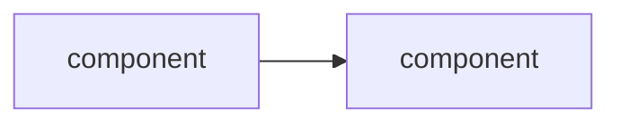
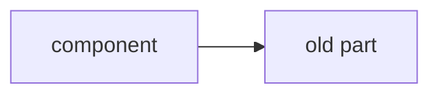
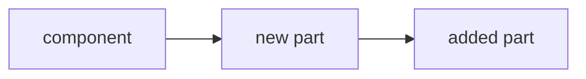

# <Project name>

## Now

<One sentence: what the system is today.>



| metric | target | now |
|---|---|---|
| <the 3–6 numbers that say where it stands> | | |

### Open

- [ ] <what is unresolved, one line each>

## Terms

- **<term>**: <what it is, one line, for someone who hasn't read the code.>

## Log

### YYYY-MM-DD · <What changed, ≤ 8 words>

> <One line, ≤ 30 words: the change and its effect, with a number if there is one.>

#### Before



#### After



#### Example

```scenario
{"title": "<what went wrong, in one line>", "unit": "cycle", "illustrative": true,
 "lanes": ["<actor or resource>", "<actor or resource>"],
 "before": {"caption": "<why it failed>", "result": "<outcome>",
   "events": [{"lane": "<actor>", "from": 0, "to": 4, "text": "<doing>"},
              {"lane": "<actor>", "at": 4, "text": "<the failure>", "status": "bad"}]},
 "after": {"caption": "<why it works now>", "result": "<outcome>",
   "events": [{"lane": "<actor>", "from": 0, "to": 4, "text": "<doing>"},
              {"lane": "<actor>", "at": 4, "text": "<the fix>", "status": "good"}]}}
```

#### Decisions

- **<Decision, ≤ 8 words>.** <Why, one sentence.>
- **Rejected: <alternative>.** <Why not, one sentence.>

#### Results

| <what was measured> | before | after |
|---|---|---|

#### Open

- [ ] <what this change leaves unresolved>
